

# ⚖️ AI DEBATE ARENA

### Voice of Minds

**Two artificial minds. One argument. Four rounds. One verdict.**

A cinematic, voice-first AI debate experience featuring procedural 3D characters, expressive neural voices, dynamic cinematography, a reactive soundtrack, and a referee that evaluates the debate and announces a winner.

  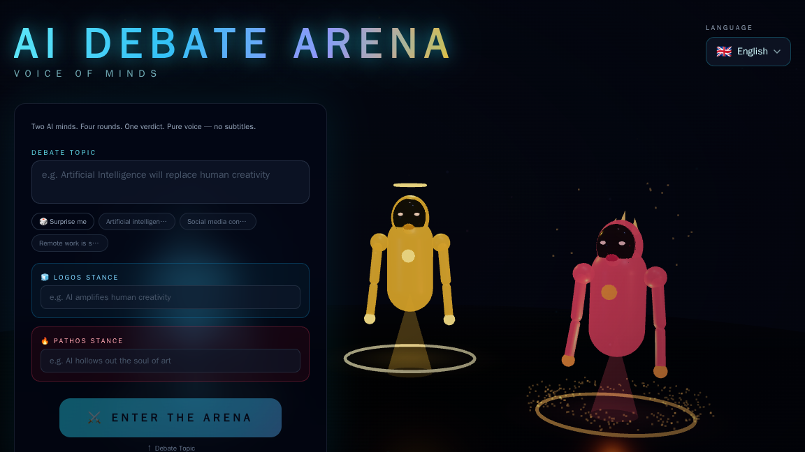

  
  
  
  
  

  <a href="#-experience-gallery">Screenshots</a> ·
  <a href="#-quick-start">Quick Start</a> ·
  <a href="#-architecture">Architecture</a> ·
  <a href="#-configuration">Configuration</a> ·
  <a href="#-api-reference">API Reference</a>

---

## 🎭 What is AI Debate Arena?

AI Debate Arena turns a topic into a staged, four-round debate between two distinct AI characters:

- **LOGOS** — the analytical thinker, arguing through structure, logic, and evidence.
- **PATHOS** — the passionate orator, using rhetoric, emotional emphasis, and rebuttals.
- **THE REFEREE** — an authoritative judge who evaluates the completed debate, scores it across five criteria, and delivers a spoken verdict.

The experience is designed as a cinematic performance rather than a conventional chat window. Procedural 3D characters react to speech, the camera changes with the dramatic arc, and the soundtrack responds to the action. At the end, a gavel strike, shifting scales, victory effects, and a score summary close the show.

**Core idea:** the audience hears the debate and watches it unfold. Spoken arguments are not presented as a running subtitle transcript over the arena.

## ✨ Highlights

| Experience | What it does |
|---|---|
| 🧠 Debate generation | Generates a structured eight-turn script: two speakers across four rounds, with each turn assigned an emotion, intensity, and gesture. |
| ⚖️ Referee and scoring | Evaluates the actual debate transcript across **Logic, Evidence, Rhetoric, Rebuttal, and Emotional Impact**, then generates a spoken verdict. |
| 🎙️ Multi-provider speech | Tries the configured voice-provider chain: Groq Orpheus, optional ElevenLabs, and Microsoft Edge neural voices, with browser speech as a client-side fallback. |
| 🎭 Procedural 3D cast | Builds LOGOS, PATHOS, and the REFEREE with Three.js / React Three Fiber components, without requiring downloaded character-model files. |
| 👄 Audio-reactive animation | Audio amplitude drives mouth/jaw movement, head motion, glow, and character energy. This is amplitude-driven animation, not phoneme-perfect lip-sync. |
| 🎥 Virtual cinematographer | Uses changing camera shots, close-ups, reaction shots, push-ins, intensity-based shake, and letterbox framing to support the story. |
| 🎼 Procedural soundtrack | Synthesizes atmospheric pads, heartbeat-like tension, risers, impacts, victory music, and ducking beneath speech through Web Audio. |
| 🌍 16 languages | English, Arabic, Spanish, French, German, Chinese, Japanese, Russian, Portuguese, Hindi, Turkish, Indonesian, Italian, Korean, Dutch, and Polish. Arabic supports right-to-left interface layout. |
| 🏆 Victory sequence | Includes a winner reveal, score summary, trophy and confetti effects, and a dance mode with a keyboard Easter egg. |
| 👤 Accounts and profiles | Optional Google, GitHub, and Discord OAuth through Auth.js / NextAuth. Members can maintain a profile and inspect their usage quota. |
| 🎟️ Usage plans | Includes guest and member quotas, a plan catalogue, and Lemon Squeezy checkout/webhook integration. Payment features require provider credentials and live configuration before production use. |
| ⚡ Performance and resilience | Lazy-loads the 3D arena, caches generated scripts and audio in an LRU cache, tries model fallbacks, and retries malformed debate output. |

## 🖼️ Experience gallery

The following images are repository screenshots under the **docs/** directory.

  
  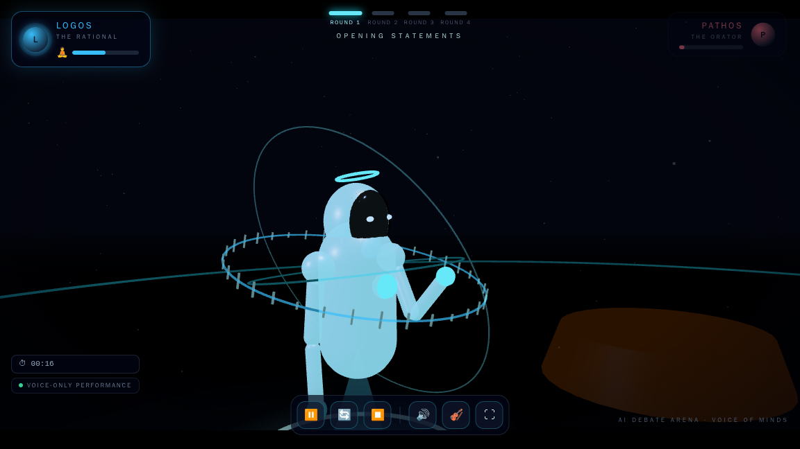
  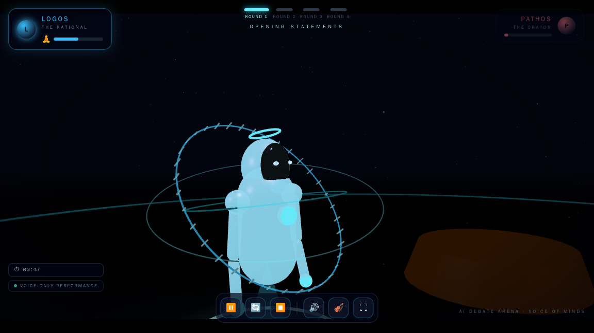
  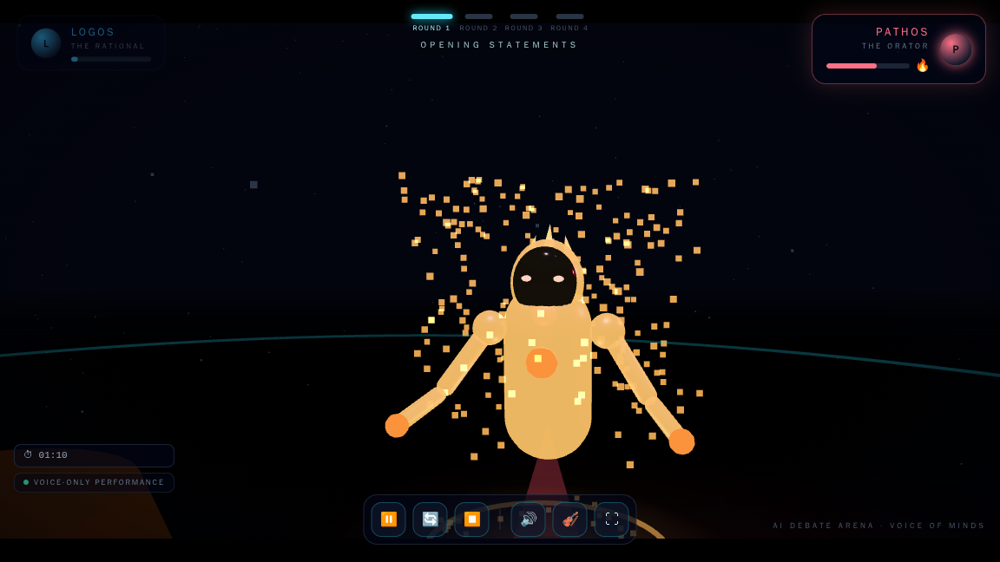
  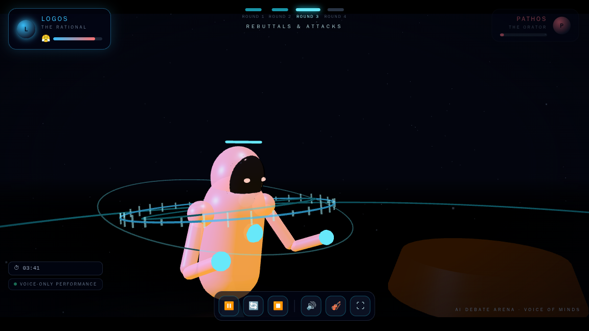
  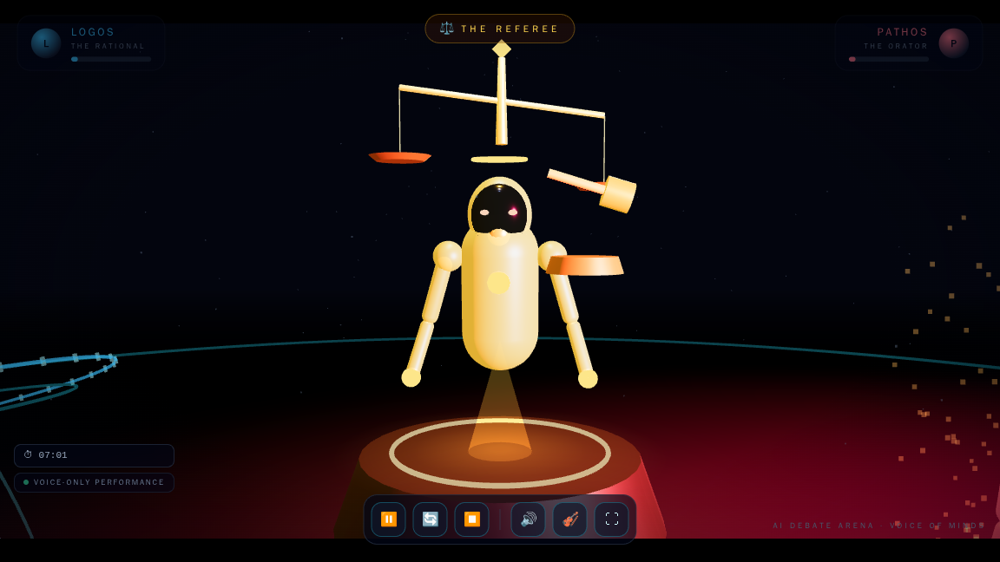
  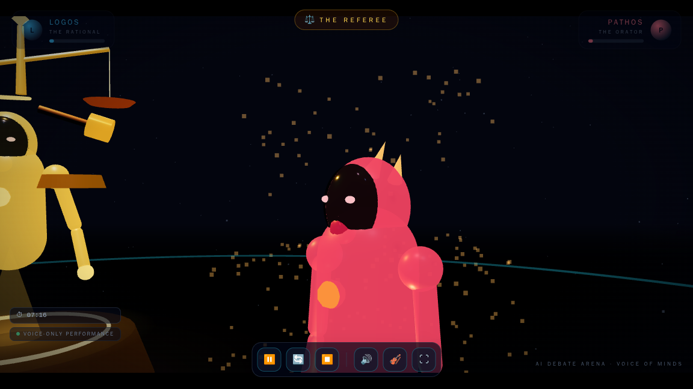
  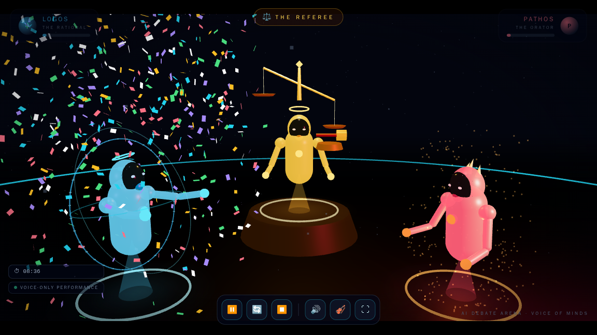
  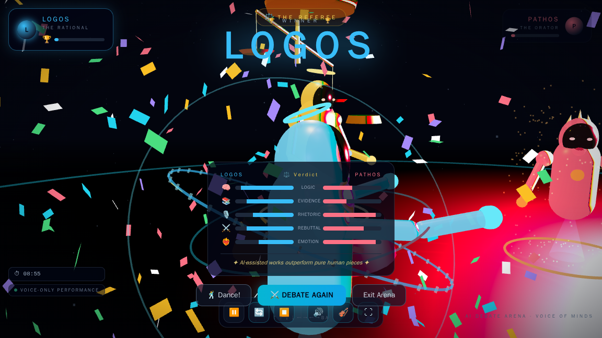
  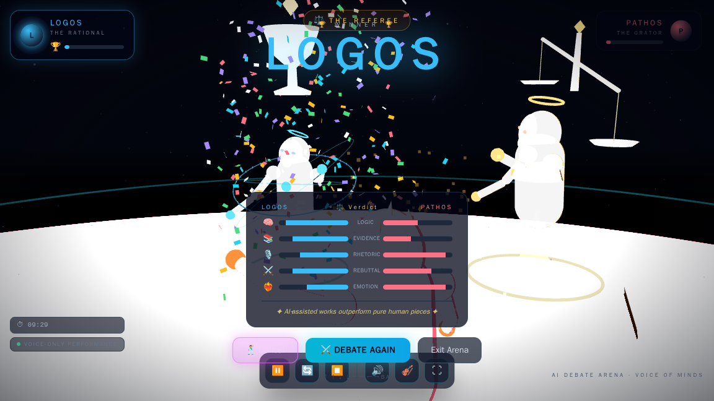

<strong>Additional interface captures</strong>

  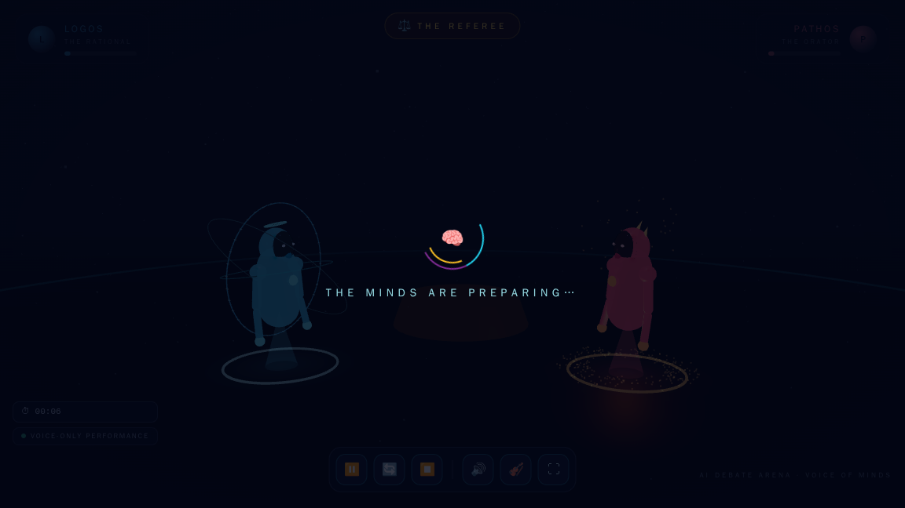
  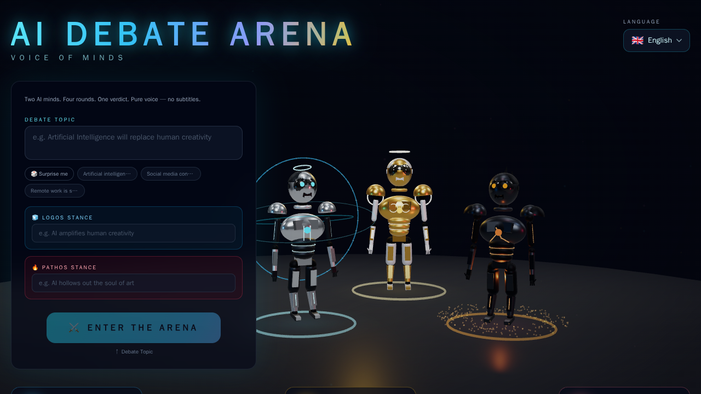
  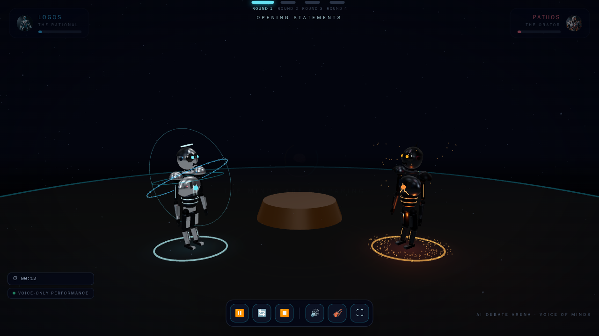
  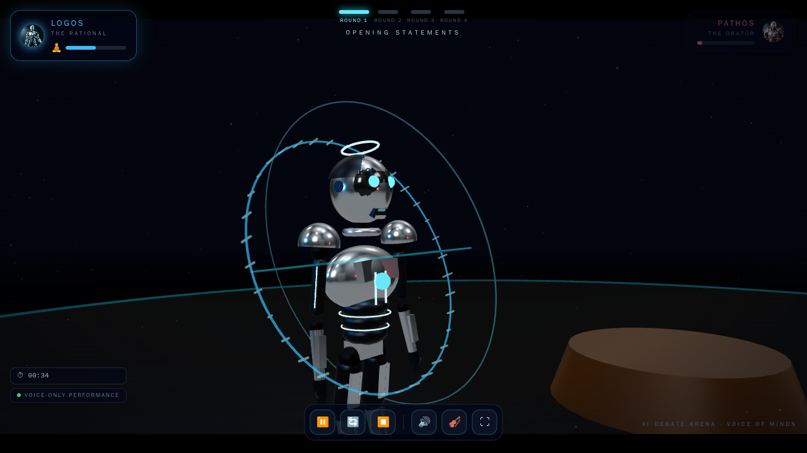
  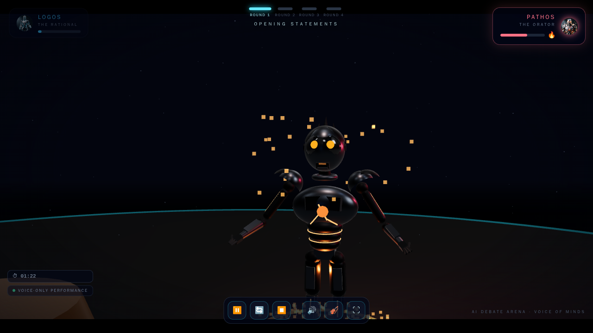
  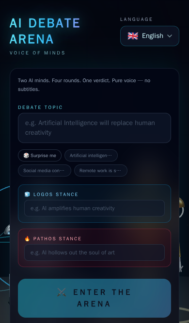
  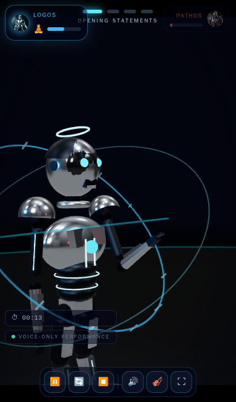

## 🚀 Quick Start

### Requirements

- **Node.js 18.17 or newer** (Node.js 20 LTS is a good default).
- npm, included with Node.js.
- A **Groq API key** for AI debate-script generation and referee verdicts.
- An up-to-date browser with WebGL and audio support.
- Optional credentials for premium speech, OAuth sign-in, persistent storage, and payments.

> The Microsoft Edge neural voice provider does not require its own API key. However, a Groq API key is required for the AI to generate a debate and verdict.

### 1. Clone the project

~~~bash
git clone https://github.com/computerengineer1/ai-debate-arena.git
cd ai-debate-arena
~~~

### 2. Install dependencies

~~~bash
npm ci
~~~

### 3. Create your environment file

macOS / Linux:

~~~bash
cp .env.example .env
~~~

Windows PowerShell:

~~~powershell
Copy-Item .env.example .env
~~~

Open **.env** and set at least your Groq API key:

~~~dotenv
GROQ_API_KEY=your_groq_api_key_here
~~~

Get a key from the [Groq Console](https://console.groq.com/keys). Do not commit the **.env** file or paste real keys into issues, screenshots, or public logs.

### 4. Start the development server

~~~bash
npm run dev
~~~

Open **http://localhost:3000** in your browser. Enter a topic, choose the speakers' positions and language, and start the debate.

### 5. Create a production build

~~~bash
npm run typecheck
npm run build
npm start
~~~

The production server listens on the configured port; set **PORT** on hosts that require a specific port.

## 🧭 What happens during a debate?

1. **Configure the topic.** Enter a debate question, the positions for LOGOS and PATHOS, and a language.
2. **Generate the script.** The server requests a structured eight-turn script from the configured Groq model chain.
3. **Open the arena.** The virtual stage, lighting, atmosphere, camera system, and character animation are initialized.
4. **Play four rounds.** The speakers alternate between openings, evidence, rebuttals, and closing arguments. Emotion and intensity influence voice prosody and the visual performance.
5. **Enter the referee.** After the debate, the referee evaluates the actual transcript.
6. **Deliver the verdict.** The app presents the referee's spoken judgment, a gavel moment, and a five-axis score summary.
7. **Celebrate or rematch.** The winner sequence includes visual effects and an optional dance-mode Easter egg.

### Emotional turn format

Each generated turn is normalized into a predictable structure before it is consumed by the visual and audio systems:

~~~json
{
  "speaker": "pathos",
  "round": 3,
  "text": "A sample spoken argument goes here.",
  "emotion": "passionate",
  "intensity": 0.9,
  "gesture": "open_hands"
}
~~~

The application validates and normalizes speaker, round, emotion, intensity, and gesture values. The frontend maps these attributes to character poses, lighting and aura effects, voice delivery, soundtrack tension, and camera behavior.

## 🏗️ Architecture

~~~mermaid
flowchart TD
    U["Browser / Next.js UI"] --> L["Landing and debate setup"]
    U --> A["Arena UI and 3D Canvas"]
    L --> D["POST /api/debate"]
    A --> D
    D --> P["Prompt builder and output normalization"]
    P --> G["Groq model chain"]
    A --> T["POST /api/tts"]
    T --> V["Orpheus → ElevenLabs → Edge TTS"]
    V --> AU["Audio playback and Web Audio analysis"]
    AU --> AV["Lip motion, animation, and music ducking"]
    A --> R["Client-side show director / Zustand"]
    R --> C["Camera, poses, stage, effects, and score"]
    U --> AUTH["Auth.js OAuth sessions"]
    AUTH --> PROF["Profile and quota endpoints"]
    PROF --> KV["Upstash Redis or in-memory fallback"]
    BILL["Lemon Squeezy events"] --> WH["POST /api/billing/webhook"]
    WH --> KV
~~~

### Main design choices

- **Next.js App Router:** serves the landing page, arena, profile page, and server-side route handlers.
- **Server-side AI calls:** Groq keys are used by server code, not embedded in client components.
- **React Three Fiber and Three.js:** render the stage, avatars, camera movement, and visual effects.
- **Zustand:** shares arena and language state between UI components.
- **Web Audio API:** handles playback analysis, the procedural score, speech ducking, and audio-reactive animation.
- **Provider abstraction:** the TTS implementation is isolated in a server module so provider order and credentials can be configured through environment variables.
- **Optional storage:** Upstash Redis provides persistence for quota, profile, subscription, and related data where configured; the in-memory fallback is intended for local development or a single short-lived instance.

## 🗣️ Languages and voice providers

The application includes 16 language configurations. Each language maps to neural voice choices for LOGOS, PATHOS, and the REFEREE, plus character-specific voice settings. Arabic is configured for right-to-left UI presentation, with an Arabic-specific LLM option in the model chain.

### Voice-provider order

The default provider order is:

1. **Groq Orpheus** — emotion-tagged speech for supported languages; requires Groq credentials and acceptance of the relevant model terms.
2. **ElevenLabs** — optional multilingual speech; requires an ElevenLabs API key.
3. **Microsoft Edge neural voices** — the no-extra-key provider configured for supported languages.
4. **Browser Web Speech API** — client-side fallback if server-side synthesis fails.

Configure the order with **TTS_PROVIDER_CHAIN**. A provider may be skipped or fall through when it is not configured, is unsupported for the selected language, or returns an error.

- [Groq API keys](https://console.groq.com/keys)
- [Groq Orpheus model terms](https://console.groq.com/playground?model=canopylabs%2Forpheus-v1-english)
- [ElevenLabs](https://elevenlabs.io/)

## 🔐 Accounts, quotas, and billing

The repository includes more than the cinematic debate UI.

### Authentication and profiles

Auth.js / NextAuth uses JWT sessions and can enable any of these OAuth providers when its credentials are present:

- Google
- GitHub
- Discord

No OAuth provider is mandatory for running the local development server, but sign-in features remain unavailable until one is configured. Member profiles store a display name, short bio, and title.

### Quota and plan catalogue

The plan rules are defined in **src/lib/server/quota.ts**. The current code configures:

| Plan | Configured price | Debate allowance | Advertised benefits |
|---|---:|---|---|
| **Sophist** | Free | 5 per week for signed-in members; one guest debate | Core experience and 16 languages |
| **Orator** | $4.99 / month | Unlimited | Ad-free experience and additional voice / export perks |
| **Legend** | $11.99 / month | Unlimited | Orator benefits plus additional persona and creator-oriented perks |

Weekly counters roll over using an ISO-week key. Paid checkout URLs and subscription variants must be configured in environment variables. The plan catalogue describes the intended product tiers; verify every premium perk in a production deployment before selling access.

### Storage behavior

- **Local development:** without Upstash credentials, the app uses an in-memory map.
- **Deployed or multi-instance app:** configure Upstash Redis so quota and account-related state can persist across serverless instances.
- **Important limitation:** in-memory state is not durable and is not shared across instances. It should not be treated as production persistence.

### Payment integration

Lemon Squeezy checkout URLs are served by the plan endpoint, and the webhook handler validates an HMAC-SHA256 signature using **LS_WEBHOOK_SECRET**, then records event IDs to reduce duplicate processing. The integration is not live until products, variant identifiers, checkout URLs, and webhook settings are configured and tested in the provider dashboard.

## ⚙️ Configuration

The full template is in **.env.example**. Keep secrets on the server and configure only the integrations you intend to use.

| Variable | Required? | Purpose |
|---|---|---|
| **GROQ_API_KEY** | **Yes for AI debates** | Groq requests for script and verdict generation. |
| **GROQ_MODEL** | Optional | Primary model; defaults to **qwen/qwen3.8-27b** in server code. |
| **GROQ_FALLBACK_MODEL** | Optional | First fallback model; defaults to **openai/gpt-oss-120b**. |
| **GROQ_FALLBACK_MODEL2** | Optional | Additional fallback; defaults to **openai/gpt-oss-20b**. |
| **GROQ_MODEL_AR** | Optional | Arabic model in the model chain; defaults to **allam-2-7b**. |
| **TTS_PROVIDER_CHAIN** | Optional | Ordered speech providers; default is **orpheus,elevenlabs,edge**. |
| **ELEVEN_API_KEY** | Optional | Enables ElevenLabs speech synthesis. |
| **ELEVEN_MODEL** | Optional | ElevenLabs model ID; template defaults to **eleven_multilingual_v2**. |
| **ELEVEN_VOICE_LOGOS**, **ELEVEN_VOICE_PATHOS**, **ELEVEN_VOICE_REFEREE** | Optional | Per-character ElevenLabs voice IDs. |
| **ORPHEUS_VOICE_LOGOS**, **ORPHEUS_VOICE_PATHOS**, **ORPHEUS_VOICE_REFEREE** | Optional | Per-character Orpheus voice selection. |
| **AUTH_SECRET** | Recommended for deployed auth | Secret used by Auth.js. Use a strong, private value. |
| **GOOGLE_CLIENT_ID**, **GOOGLE_CLIENT_SECRET** | Optional | Google OAuth. |
| **GITHUB_CLIENT_ID**, **GITHUB_CLIENT_SECRET** | Optional | GitHub OAuth. |
| **DISCORD_CLIENT_ID**, **DISCORD_CLIENT_SECRET** | Optional | Discord OAuth. |
| **UPSTASH_REDIS_REST_URL**, **UPSTASH_REDIS_REST_TOKEN** | Optional | Persistent storage for quotas, profiles, and subscriptions. |
| **REDIS_URL** | Optional | Redis cache integration point noted by the cache configuration. Verify the selected cache backend before relying on it. |
| **APP_URL** | Optional | Public-origin override used by application cache keys. |
| **LS_CHECKOUT_ORATOR**, **LS_CHECKOUT_LEGEND** | Optional | Lemon Squeezy hosted checkout URLs. |
| **LS_VARIANT_ORATOR**, **LS_VARIANT_LEGEND** | Optional | Product variant IDs mapped to subscription plans by the webhook. |
| **LS_WEBHOOK_SECRET** | Optional | Required to validate Lemon Squeezy webhook signatures. |
| **NEXT_PUBLIC_ADSENSE_CLIENT** and slot IDs | Optional | AdSense publisher and placements. |

**Additional integration note:** the webhook code also recognizes **LS_PRODUCT_ORATOR** and **LS_PRODUCT_LEGEND** as product-ID mappings. They are not listed in the current **.env.example**; add them to your deployment environment only if you use that product-ID mapping path.

## 🧩 Project structure

~~~text
ai-debate-arena/
├── docs/                         # Visual QA screenshots
├── public/                       # Public static assets
├── scripts/
│   ├── e2e-visual.cjs             # Full-debate visual rehearsal
│   ├── verify-dev-flow.cjs        # SPA entry and resume-flow check
│   └── kill_strays.py
├── src/
│   ├── app/
│   │   ├── page.tsx               # Landing page and setup console
│   │   ├── arena/page.tsx         # Cinematic debate experience
│   │   ├── profile/page.tsx       # Member profile
│   │   └── api/
│   │       ├── auth/[...nextauth]/route.ts
│   │       ├── debate/route.ts    # Script generation and referee verdict
│   │       ├── tts/route.ts       # Speech synthesis proxy
│   │       ├── voices/route.ts    # Provider / language introspection
│   │       ├── quota/route.ts     # Quota status and consumption
│   │       ├── profile/route.ts   # Member profile read / update
│   │       └── billing/
│   │           ├── plans/route.ts
│   │           └── webhook/route.ts
│   ├── components/
│   │   ├── three/                 # Avatars, stage, camera, and effects
│   │   └── ui/                    # HUD, controls, overlays, and modals
│   ├── i18n/dictionaries.ts       # Localized interface text
│   ├── lib/
│   │   ├── client/                # Director, audio, music, hooks
│   │   ├── server/                # Groq, TTS, prompts, cache, KV, quotas
│   │   ├── languages.ts
│   │   └── types.ts
│   ├── auth.ts                    # Auth.js providers and identity resolution
│   └── store/                     # Zustand stores
├── .env.example                   # Environment variable template
├── next.config.mjs
├── package.json
└── README.md
~~~

## 🔌 API reference

All routes are implemented as Next.js App Router handlers. JSON request and response shapes can evolve; consult each route source for the authoritative contract.

| Method | Endpoint | Purpose |
|---|---|---|
| **POST** | **/api/debate** | Generate the eight-turn debate script (**mode: script**) or evaluate the transcript (**mode: verdict**). |
| **POST** | **/api/tts** | Generate speech for a validated speaker, language, text, and emotion; returns base64 audio with provider metadata. |
| **GET** | **/api/voices** | Inspect configured voice providers, supported language codes, and voice options. |
| **GET** | **/api/quota** | Read a caller's plan and remaining quota. |
| **POST** | **/api/quota** | Consume one debate from the caller's quota. |
| **GET** | **/api/profile** | Read the authenticated member profile and quota. |
| **POST** | **/api/profile** | Update a signed-in member's display name, bio, and title. |
| **GET** | **/api/billing/plans** | Return the plan catalogue and configured checkout URLs. |
| **POST** | **/api/billing/webhook** | Verify and process configured Lemon Squeezy events. |
| **GET** | **/api/auth/*** | Auth.js / NextAuth OAuth and session handlers. |
| **GET** | **/ads.txt** | Return the publisher record when AdSense is configured. |

### Debate endpoint overview

The script request accepts topic, stances, language, and mode. The route validates supported languages and topic length, extracts JSON from model responses, normalizes output fields, and uses a model chain with retry/repair behavior.

The verdict mode scores the completed transcript. The TTS route validates the speaker and language and calls the configured speech-provider chain. Error responses should be handled by the UI; speech synthesis failure can trigger client-side browser speech fallback.

## 🧪 Validation and QA scripts

The repository includes scripts for local validation. These commands are documented from the checked-in scripts; they have **not** been executed as part of this README update.

### Type checking and production build

~~~bash
npm run typecheck
npm run build
~~~

### Full-debate visual rehearsal

The script in **scripts/e2e-visual.cjs** drives a debate in Chromium and captures screenshots for the major acts. It requires a running app, a usable Groq key, Playwright Core, and a Chromium installation.

~~~bash
npm install --no-save playwright-core
npx playwright-core install chromium
npm run dev
~~~

In another terminal:

~~~bash
node scripts/e2e-visual.cjs http://localhost:3000
~~~

### SPA entry and resume behavior

The script in **scripts/verify-dev-flow.cjs** checks that the show starts after client-side navigation and that reloading presents a resume action rather than silently restarting playback.

~~~bash
node scripts/verify-dev-flow.cjs http://localhost:3000
~~~

The end-to-end scripts can take several minutes because they exercise real generation and the complete speech / cinematic sequence. External provider availability and API limits can affect results.

## 🚢 Deployment

### Vercel

Vercel is a straightforward fit for the Next.js application and its Node.js API routes.

1. Import the repository into Vercel.
2. Set **GROQ_API_KEY** and any optional provider credentials in the project's environment settings.
3. Configure **APP_URL** with the deployed origin.
4. For OAuth, create provider applications and set callback URLs to **https://YOUR-DOMAIN/api/auth/callback/google**, **https://YOUR-DOMAIN/api/auth/callback/github**, or **https://YOUR-DOMAIN/api/auth/callback/discord**.
5. Configure Upstash if quotas and profiles must survive deployments and work across instances.
6. Configure and test Lemon Squeezy only if paid plans are being offered.

The app uses Node.js route handlers with extended generation timeouts. Confirm your hosting plan's function duration and provider limits before assuming long AI/TTS requests will fit.

### Other Node.js hosts

~~~bash
npm ci
npm run build
npm start
~~~

Set the required environment variables in the host dashboard. Use a persistent external KV store for production identity, quota, and subscription state; an in-memory map is not a durable multi-instance database.

## 🛡️ Security and operational notes

- Keep **.env** and all API keys out of source control. Rotate any credential that has been exposed.
- Groq and TTS credentials are used by server-side routes; never move them to **NEXT_PUBLIC_*** variables.
- The app sends debate topics and stance text to the configured LLM provider. Speech text is sent to whichever TTS provider is selected. Review those providers' terms and privacy policies for your deployment.
- Profile and quota mutation routes include same-origin checks and rate limiting. The billing webhook validates its signature with a timing-safe comparison.
- The application configures security response headers, including **X-Content-Type-Options**, **X-Frame-Options**, and a restrictive permissions policy.
- Configure OAuth callback URLs and **AUTH_SECRET** correctly before enabling sign-in for real users.
- Test webhook event handling, subscription cancellation / expiry, quotas, provider fallbacks, and failed upstream requests before collecting payments.
- No root-level **LICENSE** file is present in the repository at the time of this update. Do not assume the project is open-source licensed for redistribution until the owner adds a license.

## 🎮 Controls and Easter eggs

| Input | Action |
|---|---|
| **Space** | Pause or resume the show. |
| **Esc** | Stop and exit the arena. |
| **D** on the victory screen | Toggle dance mode. |
| **↑ ↑ ↓ ↓ ← → ← → B A** | Konami code: trigger the dance-mode Easter egg. |

Browser autoplay policies may block sound until the user interacts with the page. If the first voice does not play, click or tap the page and retry.

## 🧰 Troubleshooting

| Problem | Suggested check |
|---|---|
| Debate generation fails immediately | Confirm **GROQ_API_KEY** is present in **.env**, valid, and available to the current environment. |
| Model returns an error or rate limit | Check Groq model availability and quotas. The server has a fallback chain, but all configured models can still fail. |
| Orpheus does not produce audio | Accept the relevant model terms in the Groq console or let the provider chain fall through to another configured voice provider. |
| ElevenLabs is skipped | Confirm **ELEVEN_API_KEY** and **TTS_PROVIDER_CHAIN**; check that the requested language and voice IDs are supported. |
| First playback is silent | Interact with the page to satisfy the browser's audio autoplay policy. |
| Profile or quotas reset after a deploy | Configure both **UPSTASH_REDIS_REST_URL** and **UPSTASH_REDIS_REST_TOKEN**; the local fallback is in memory. |
| Checkout link is absent | Add the corresponding Lemon Squeezy checkout URL and variant IDs to the deployment environment. |
| OAuth provider does not appear | Add that provider's client ID and secret, set **AUTH_SECRET**, and verify the provider callback URL. |
| Local 3D rendering is slow | Update the browser and GPU driver, close GPU-heavy applications, and verify WebGL support. Software-rendered Chromium is useful for QA but can be slower than a normal GPU-backed browser. |

## 🛣️ Potential next improvements

- Phoneme-level visemes using a dedicated lip-sync pipeline, beyond amplitude-driven jaw animation.
- Optional imported character rigs behind the current procedural avatar interface.
- Shared Redis-backed response and audio cache for larger deployments.
- Audience voting, crowd reactions, saved debate history, and shareable debate clips.
- More automated CI coverage for API contracts, webhook edge cases, and quota concurrency.

## 🇱🇧 ملخص بالعربية

**AI Debate Arena — ساحة المناظرات الذكية** هو تطبيق ويب يحوّل أي موضوع إلى مناظرة سينمائية من أربع جولات بين شخصيتين ذكيتين: **LOGOS** الذي يمثّل التفكير المنطقي، و**PATHOS** الذي يمثّل الخطاب العاطفي. بعد انتهاء المناظرة، يدخل الحكم **THE REFEREE** ويقيّم الحجج وفق خمسة معايير ثم يعلن الفائز بصوت مسموع، مع مؤثرات ثلاثية الأبعاد وموسيقى وحركة كاميرا متغيّرة.

المشروع مبني باستخدام Next.js وReact وTypeScript وThree.js وGroq. يدعم 16 لغة، ويستخدم سلسلة مزوّدات للصوت مع خيارات تسجيل الدخول والملفات الشخصية والحصص الأسبوعية والخطط المدفوعة عند إعداد مفاتيحها. لتشغيله محلياً، ثبّت الحزم باستخدام **npm ci**، وانسخ **.env.example** إلى **.env**، وضع مفتاح Groq في **GROQ_API_KEY**، ثم شغّل **npm run dev**.

> قبل إطلاق نسخة عامة أو تفعيل الاشتراكات، يجب إعداد مفاتيح الخدمات والتخزين الدائم وOAuth والدفع، واختبار تدفّق الاشتراك والخصوصية والحصص فعلياً. لا تُرسل مفاتيحك السرية إلى GitHub.

---

**Built for maximum drama. May logic — or passion — prevail.** ⚖️🔥🧊

Repository: <a href="https://github.com/computerengineer1/ai-debate-arena">computerengineer1/ai-debate-arena</a>

